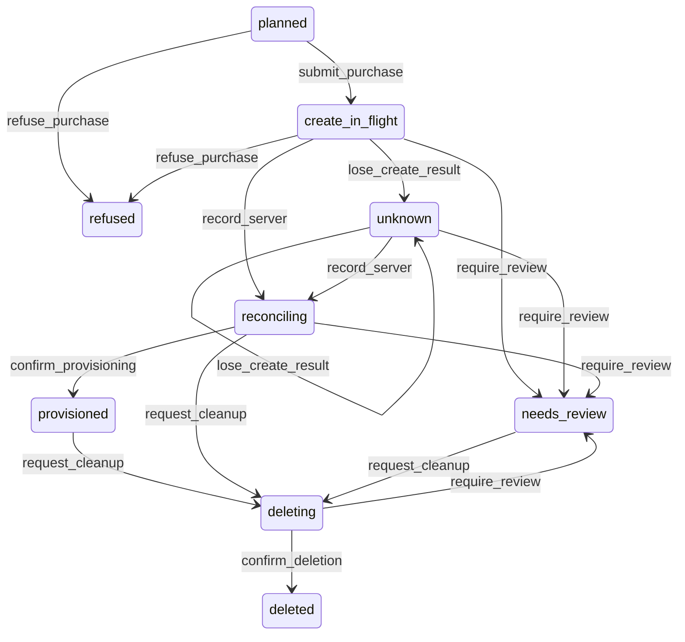
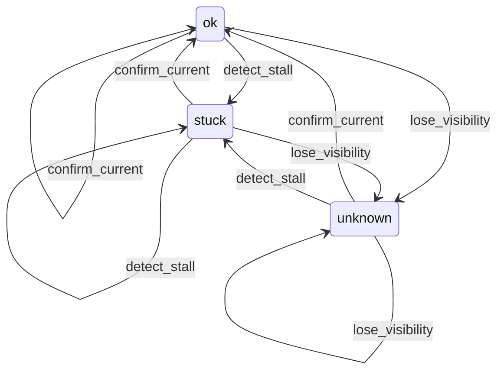
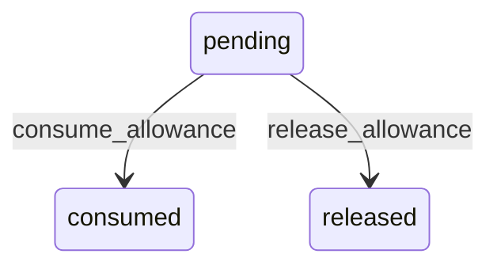
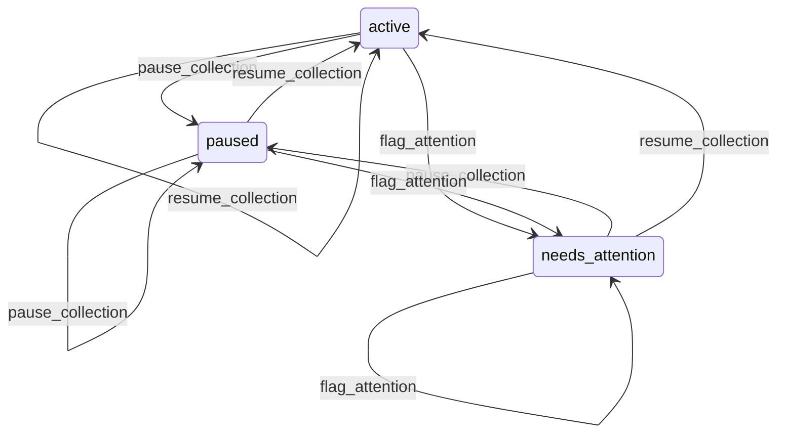
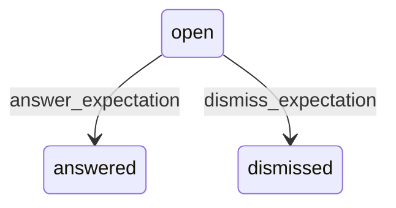
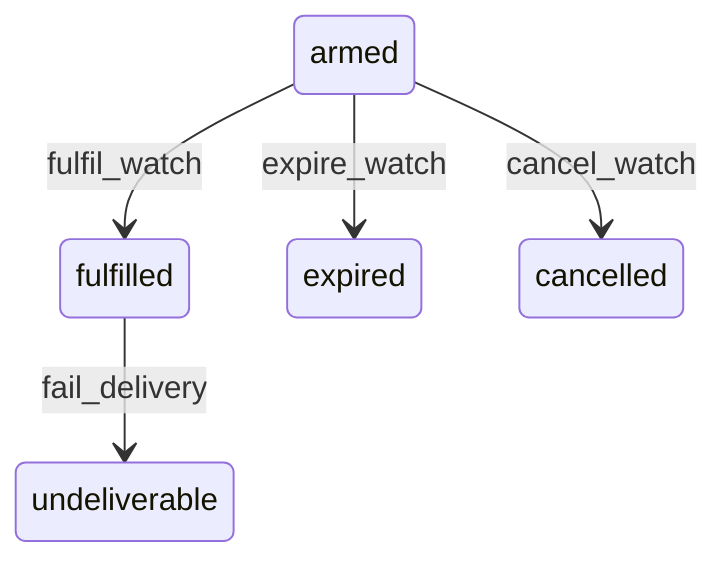
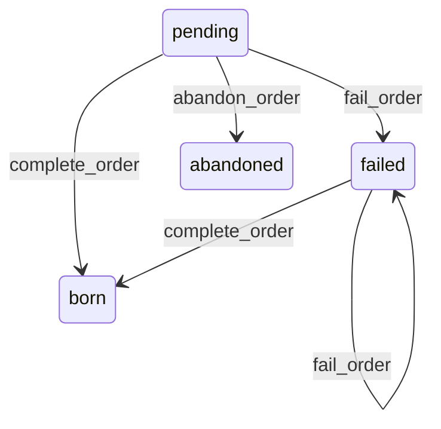
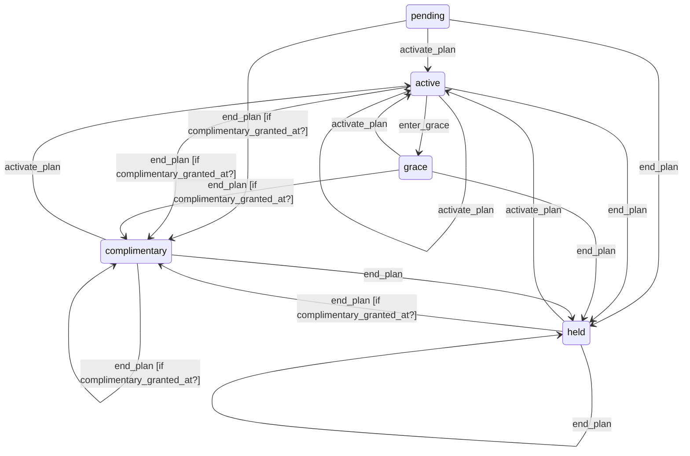

# State machines

<!-- Generated by bin/rails state_machines:diagrams. -->

## CloudProcurementOperation

## DeployAlarmState

## FieldRecordingReservation

## FieldTweetSource

## ReplyExpectation

## RepositoryWatch

## ResidentBirthOrder

## ResidentEntitlement

